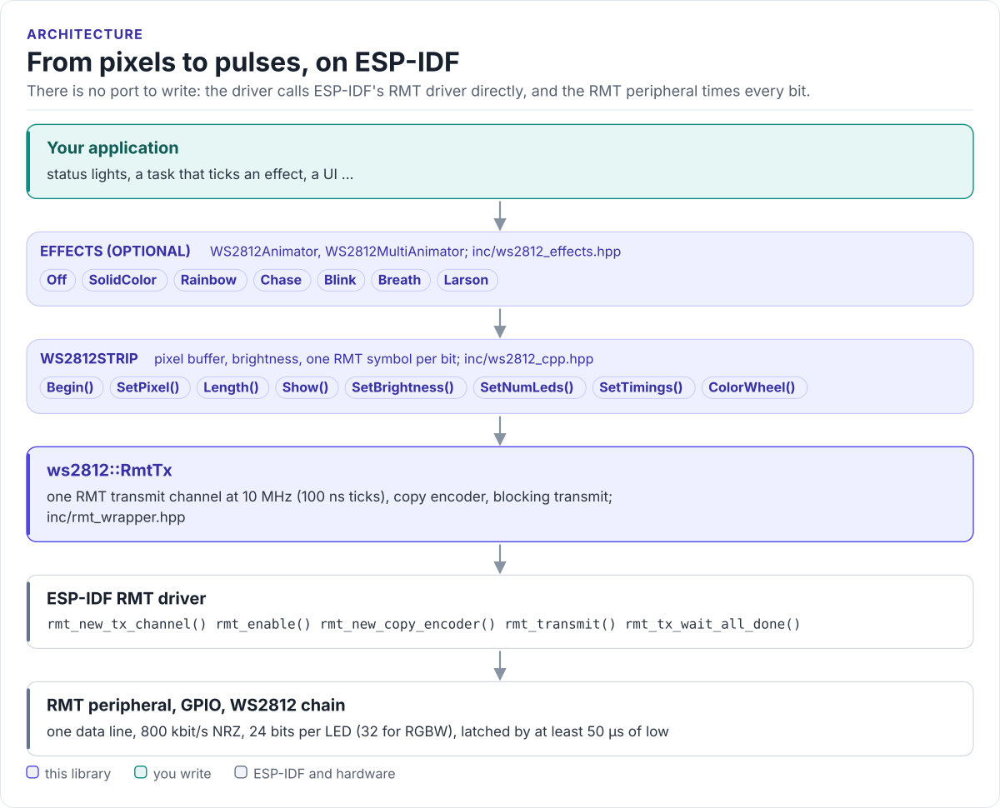

# WS2812 RMT Driver

A C++ driver for WS2812 / WS2812B addressable LEDs (NeoPixels) on the ESP32 family: pixels, brightness, RGB and
RGBW, with the bit timing generated by the RMT peripheral, plus animation effects. ESP-IDF v5.3 or later only.

[](https://github.com/hardfoc/hf-ws2812-rmt-driver/actions/workflows/ci-host-tests.yml)
[](https://github.com/hardfoc/hf-ws2812-rmt-driver/actions/workflows/esp32-examples-build-ci.yml)
[](https://hardfoc.github.io/hf-ws2812-rmt-driver/)
[](LICENSE)

**Documentation: <https://hardfoc.github.io/hf-ws2812-rmt-driver/>**

<!-- figure: driver-layers -->
<picture>
  <source media="(prefers-color-scheme: dark)" srcset="docs/diagrams/driver-layers.dark.svg">
  
</picture>
<!-- /figure -->

## In 30 seconds

Wire the strip's DIN to a GPIO through a 5 V level shifter, add the component
([Installation](https://hardfoc.github.io/hf-ws2812-rmt-driver/latest/installation/)), then:

<!-- generated: quickstart-code -->
```cpp
#include "esp_log.h"
#include "freertos/FreeRTOS.h"
#include "freertos/task.h"
#include "ws2812_cpp.hpp"

// WS2812B bit timing in RMT ticks of 100 ns (the driver runs the RMT at 10 MHz).
constexpr uint16_t kT0H = 4, kT1H = 8, kT0L = 9, kT1L = 5;

extern "C" void app_main() {
  // 8 LEDs on GPIO8, brightness 32 of 255. The constructor claims an RMT TX channel.
  WS2812Strip strip(GPIO_NUM_8, -1, 8, LedType::RGB, kT0H, kT1H, kT0L, kT1L, 32);
  if (strip.Begin() != ESP_OK) { // no free RMT channel, or a bad GPIO
    ESP_LOGE("leds", "RMT channel set-up failed");
    return;
  }

  for (uint32_t i = 0;; i = (i + 1) % strip.Length()) {
    strip.SetPixel(i, 0xFF0000);  // 0xRRGGBB: one red LED walks along the strip
    if (strip.Show() != ESP_OK) { // blocks until the frame is on the wire
      ESP_LOGE("leds", "RMT transmit failed");
    }
    strip.SetPixel(i, 0);
    vTaskDelay(pdMS_TO_TICKS(100));
  }
}
```
<!-- /generated -->

The timing arguments are RMT ticks of 100 ns, and colours are `0xRRGGBB` (the driver sends them green first, as a
WS2812B reads them); the [Quickstart](https://hardfoc.github.io/hf-ws2812-rmt-driver/latest/quickstart/) explains
both.

## What it does

- Drives one strip per `WS2812Strip` object on one GPIO and one RMT transmit channel, RGB (24 bits) or RGBW (32).
- Encodes each bit as an RMT symbol with the high and low times you set, so the peripheral times the pulses.
- Scales brightness at send time without touching the stored colours; resizes and retimes at run time.
- Runs effects (rainbow, chase, blink, breath, Larson scanner, solid colour) with `WS2812Animator`, and keeps
  several strips in step with `WS2812MultiAnimator`.
- ESP32 only: it calls ESP-IDF's RMT driver directly; there is no port for other MCUs.

## Install

```bash
git submodule add https://github.com/hardfoc/hf-ws2812-rmt-driver.git external/hf-ws2812-rmt-driver
cp -r external/hf-ws2812-rmt-driver/examples/esp32/components/hf_ws2812_rmt components/
```

```cmake
# top-level CMakeLists.txt, before include($ENV{IDF_PATH}/tools/cmake/project.cmake)
set(HF_WS2812_RMT_ROOT ${CMAKE_SOURCE_DIR}/external/hf-ws2812-rmt-driver CACHE PATH "WS2812 driver checkout")
```

Then `REQUIRES hf_ws2812_rmt` in your component. Details:
[Installation](https://hardfoc.github.io/hf-ws2812-rmt-driver/latest/installation/).

## Documentation

| | |
| --- | --- |
| [Quickstart](https://hardfoc.github.io/hf-ws2812-rmt-driver/latest/quickstart/) | Wire a strip, add the component, light it |
| [Hardware](https://hardfoc.github.io/hf-ws2812-rmt-driver/latest/hardware/) | Pins, level shifting, bit timing, power |
| [API guide](https://hardfoc.github.io/hf-ws2812-rmt-driver/latest/api-guide/) | Pixels, brightness, effects, several strips, errors |
| [Signal timing](https://hardfoc.github.io/hf-ws2812-rmt-driver/latest/timing/) | Ticks, frame time, memory, reset gap, colour order |
| [Porting](https://hardfoc.github.io/hf-ws2812-rmt-driver/latest/porting/) | Supported ESP32 chips and what is bound to ESP-IDF |
| [API reference](https://hardfoc.github.io/hf-ws2812-rmt-driver/latest/api/) | Doxygen, every class and member |

The pages are in [`docs/`](docs/index.md).

## Tests

```bash
cmake -S . -B build-host -DHF_WS2812_RMT_BUILD_TESTS=ON && cmake --build build-host && ctest --test-dir build-host
```

The host tests build the driver against stubs of the ESP-IDF headers and check every symbol it transmits; the code
on the documentation site is compiled by the same build.

## License

GPL-3.0. See [LICENSE](LICENSE).
