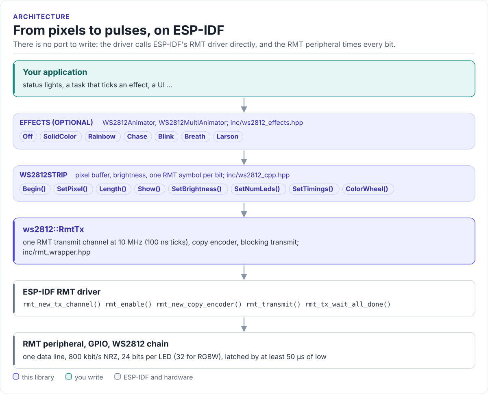
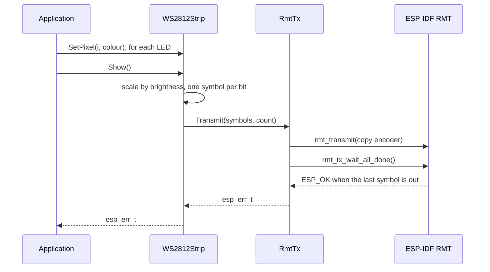

# Architecture

How the driver is put together: the layers from your application to the LEDs, what each owns, and how one frame
reaches the strip.

<!-- figure: driver-layers -->
<picture>
  <source media="(prefers-color-scheme: dark)" srcset="diagrams/driver-layers.dark.svg">
  
</picture>
<!-- /figure -->

## The layers

| Layer | Where | You change it when |
| --- | --- | --- |
| **Effects**: `WS2812Animator`, `WS2812MultiAnimator` | [`ws2812_effects.hpp`](../inc/ws2812_effects.hpp), [`ws2812_multi_animator.hpp`](../inc/ws2812_multi_animator.hpp) | You want a new effect |
| **Strip**: `WS2812Strip` | [`ws2812_cpp.hpp`](../inc/ws2812_cpp.hpp), [`ws2812_cpp.cpp`](../src/ws2812_cpp.cpp) | Never, for a new board |
| **RMT channel**: `ws2812::RmtTx` | [`rmt_wrapper.hpp`](../inc/rmt_wrapper.hpp) | Never |
| **ESP-IDF RMT driver** and the peripheral | ESP-IDF, `esp_driver_rmt` | Never |

Each layer uses only the one below it.

There is no communication interface for you to implement. The other HardFOC drivers talk to a chip over a bus
your port provides; a WS2812 has no bus, only a pulse train with 100 ns resolution, and the RMT peripheral is
what makes that possible on an ESP32 without blocking the CPU. [Porting](porting.md) explains the consequences.

## How one frame reaches the strip

`Show()` blocks the calling task for the whole frame: about 31 µs per RGB LED with the WS2812B timing
([Signal timing](timing.md)). The RMT sends the symbols on its own; the CPU only refills the channel's symbol
memory from an interrupt.

## Design choices

- **Symbols built in software, sent with a copy encoder.** `Show()` writes one `rmt_symbol_word_t` per bit into
  a buffer the strip owns, then the RMT copies them out. The timing is plain data, so `SetTimings()` takes effect
  at the next `Show()` and the host tests can check every pulse.
- **One RMT channel per strip, created in the constructor.** The channel takes one memory block of the target.
  A failure to create it does not abort: `Begin()` returns the error and retries, and `Show()` returns
  `ESP_ERR_INVALID_STATE` until the channel is up ([Troubleshooting](troubleshooting.md)).
- **Wire order inside the driver.** Pixels are `0xRRGGBB`; `Show()` reorders to green, red, blue and appends the
  reset symbol, so callers never pack for the wire.
- **Brightness at send time.** Pixels are stored unscaled; brightness is applied while encoding, so dimming and
  restoring never loses colour resolution in the buffer.
- **Effects are separate.** The strip knows nothing about animation. An animator draws one frame per `Tick()`
  and calls `Show()`; you decide when to tick.
- **Heap at construction, not per frame.** The strip allocates its pixel and symbol buffers (`std::vector`) when
  it is created or resized; `Show()` does not allocate.

## The C interface

[`inc/ws2812_control.h`](../inc/ws2812_control.h) is an older C interface for one strip whose length, LED type
and timing are fixed by Kconfig. It does not share code with `WS2812Strip`: it sends pixel bytes through
`led_strip_encoder.c`, which appends the reset ([API guide](api-guide.md#the-c-interface)).

## Source map

| Path | Contents |
| --- | --- |
| `inc/ws2812_cpp.hpp`, `src/ws2812_cpp.cpp` | `WS2812Strip`, `LedType`, version functions |
| `inc/ws2812_effects.hpp`, `src/ws2812_effects.cpp` | `WS2812Animator` and its effects |
| `inc/ws2812_multi_animator.hpp`, `src/ws2812_multi_animator.cpp` | `WS2812MultiAnimator` |
| `inc/rmt_wrapper.hpp` | `ws2812::RmtTx` (and `RmtRx`, a receive wrapper the driver does not use) |
| `inc/ws2812_control.h`, `src/ws2812_control.c`, `inc/led_strip_encoder.h`, `src/led_strip_encoder.c` | The C interface and its RMT encoder |
| `Kconfig` | Defaults for the strip constructor and the C interface |
| `tests/` | Host unit tests, ESP-IDF stubs and the compiled documentation snippets |
| `examples/esp32/` | ESP-IDF test application |
