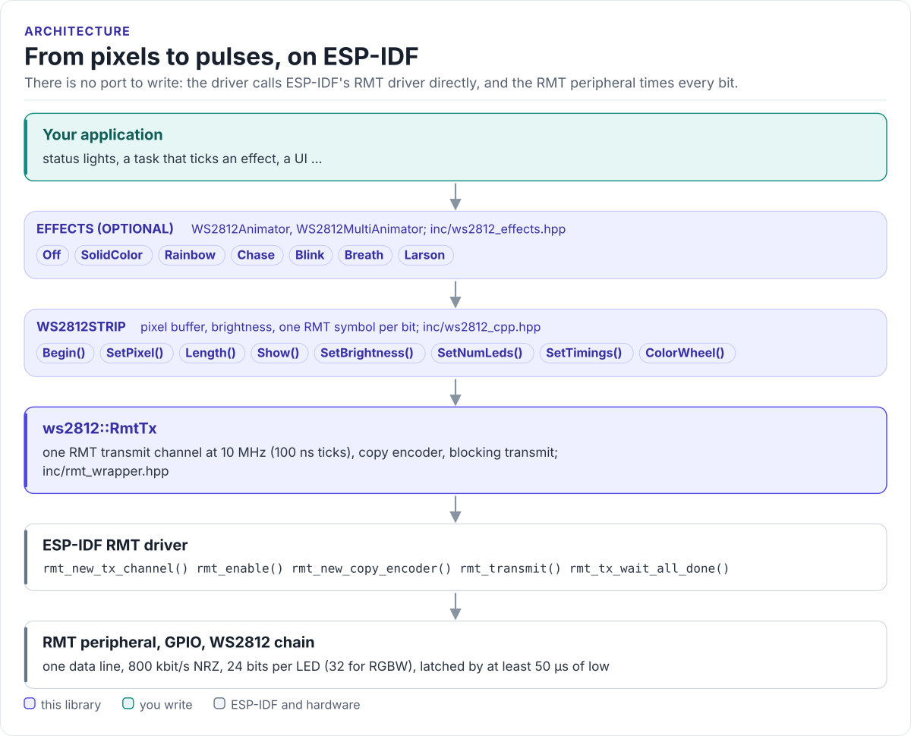

# Figures

<!-- Generated by hardfoc-docs figures from docs/diagrams/figures/*.py. Do not edit by hand. -->

Every figure on this site is drawn by a Python module from facts extracted from the code, so it is rebuilt,
not redrawn, when the code changes. CI runs `hardfoc-docs figures --check` and fails when a
committed figure no longer matches the code. Each figure below lists the files it is drawn from.

## From pixels to pulses, on ESP-IDF

<!-- figure: driver-layers -->
<picture>
  <source media="(prefers-color-scheme: dark)" srcset="driver-layers.dark.svg">
  
</picture>
<!-- /figure -->

Figure module: [`docs/diagrams/figures/driver-layers.py`](../../docs/diagrams/figures/driver-layers.py)

Drawn from:

- `WS2812Animator::Effect` in [`inc/ws2812_effects.hpp`](../../inc/ws2812_effects.hpp)
- `WS2812Strip` in [`inc/ws2812_cpp.hpp`](../../inc/ws2812_cpp.hpp)
- `ws2812::RmtTx` in [`inc/rmt_wrapper.hpp`](../../inc/rmt_wrapper.hpp)
