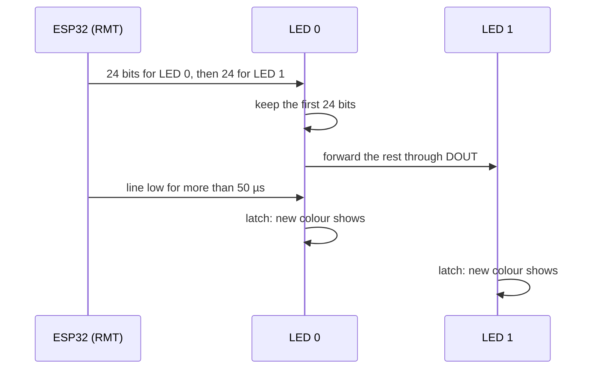

# Hardware

What to connect between an ESP32 and a WS2812B strip, the signal it expects, and how to power it.

The numbers here come from the Worldsemi [WS2812B datasheet](https://cdn-shop.adafruit.com/datasheets/WS2812B.pdf)
and, for the original WS2812, the [WS2812 datasheet](https://cdn.sparkfun.com/datasheets/Components/LED/WS2812.pdf).
Clones and later revisions differ; check the datasheet of the LEDs you bought.

## Pins

| Pin | Name | Connect to |
| --- | --- | --- |
| 1 | VDD | 5 V supply (3.5 V to 5.3 V) |
| 2 | DOUT (out) | DIN of the next LED |
| 3 | VSS | Supply ground and ESP32 ground |
| 4 | DIN (in) | ESP32 GPIO, through a level shifter |

A strip brings out VDD (often labelled 5V or +), DIN and GND at its input end. The data goes one way: connect the
end marked DIN or with the arrow pointing away from the connector.

## The ESP32 side

| Setting | Value | Notes |
| --- | --- | --- |
| Peripheral | One RMT transmit channel | Chosen by ESP-IDF's RMT driver; the `channel` argument is ignored |
| GPIO | Any output-capable GPIO | GPIO8 in the examples (ESP32-C6) |
| Resolution | 10 MHz, 100 ns per tick | Fixed by `WS2812Strip` |
| Symbol memory | 64 symbols, no DMA | Refilled by interrupt while a frame is sent |
| Output level | 3.3 V | Below the WS2812B's 3.5 V high threshold at 5 V |

## Signal

The LEDs read one line, non-return-to-zero at 800 kbit/s. Every bit is a high pulse followed by a low one; the
length of the high pulse decides 0 or 1. Each LED keeps the first 24 bits it receives and passes the rest on
through DOUT, reshaped. A low line for longer than the reset time latches the new colours into every LED.

| Parameter | WS2812B | Driver (100 ns ticks) |
| --- | --- | --- |
| T0H, 0 bit high | 0.40 µs ±150 ns | 4: 0.4 µs |
| T1H, 1 bit high | 0.80 µs ±150 ns | 8: 0.8 µs |
| T0L, 0 bit low | 0.85 µs ±150 ns | 9: 0.9 µs |
| T1L, 1 bit low | 0.45 µs ±150 ns | 5: 0.5 µs |
| TH + TL | 1.25 µs ±600 ns | 1.3 µs |
| Reset, line low | more than 50 µs | not sent ([why](timing.md#the-reset-gap)) |
| Bit order | G7 ... G0, R7 ... R0, B7 ... B0 | MSB of the value first |

The original WS2812 specifies 0.35, 0.7, 0.8 and 0.6 µs, each ±150 ns, and the same reset and order; the
driver values above fall inside both parts' windows. The driver column is what the examples on this site pass
to the constructor, not the Kconfig default ([Configuration](configuration.md)).

[Signal timing](timing.md) turns these numbers into ticks, frame times and memory.

## Logic levels

| Parameter | WS2812B | At VDD = 5 V |
| --- | --- | --- |
| VIH, input high | 0.7 × VDD minimum | 3.5 V |
| VIL, input low | 0.3 × VDD maximum | 1.5 V |
| Input voltage | −0.5 V to VDD + 0.5 V | |

!!! warning "3.3 V data into a 5 V strip"
    An ESP32's 3.3 V high is under the 3.5 V the datasheet asks for. Many strips accept it on a short wire, some
    do not, and the margin shrinks with temperature and cable length. Use a buffer powered from 5 V that accepts
    3.3 V inputs (74AHCT125, 74HCT245) between the GPIO and DIN.

## Power

| Item | Value | Source |
| --- | --- | --- |
| VDD | 3.5 V to 5.3 V | WS2812B datasheet |
| Current at full white | About 60 mA per LED | Three LEDs at 20 mA each, from the WS2812 datasheet; the WS2812B datasheet gives no figure |
| Decoupling | 100 nF at each LED | WS2812B application circuit (most strips have it) |
| Operating temperature | −25 °C to +80 °C | WS2812B datasheet |

Budget the supply for the strip: 60 LEDs at full white is about 3.6 A. Brightness scaling lowers it in
proportion. Feed long strips from both ends or every metre or so, so the far LEDs do not dim or shift colour.

Adafruit's [NeoPixel guide](https://learn.adafruit.com/adafruit-neopixel-uberguide/best-practices) adds two
parts that protect the first LED: a 300 Ω to 500 Ω resistor in series with DIN, close to the strip, and a large
capacitor (1000 µF or so) across the supply at the strip input. Connect the ground before the supply, and power
the strip before or with the ESP32, never drive DIN of an unpowered strip.

## Reference documents

| Document | What it is for |
| --- | --- |
| [WS2812B datasheet (Worldsemi)](https://cdn-shop.adafruit.com/datasheets/WS2812B.pdf) | Pins, supply, input levels, bit timing, data order |
| [WS2812 datasheet (Worldsemi)](https://cdn.sparkfun.com/datasheets/Components/LED/WS2812.pdf) | The original six-pin part: its timing and per-colour current |
| [ESP-IDF RMT documentation](https://docs.espressif.com/projects/esp-idf/en/stable/esp32c6/api-reference/peripherals/rmt.html) | Channels, symbol memory, DMA and the encoder model |
| [Adafruit NeoPixel guide](https://learn.adafruit.com/adafruit-neopixel-uberguide) | Wiring and power practice |
